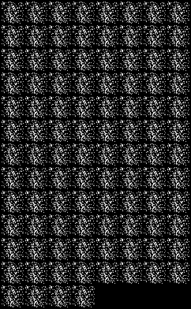
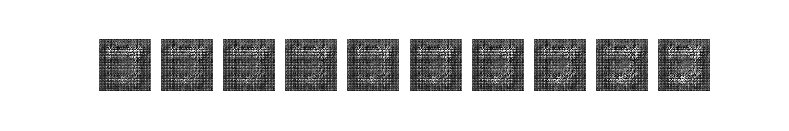

# GAN Paper Implementation

TG-WinG AI 트랙에서 GAN 원 논문(Goodfellow et al., 2014, *Generative Adversarial Nets*)을 발표하고, GAN과 DCGAN을 PyTorch로 직접 구현해 MNIST로 학습해 본 저장소입니다.

  
  

## 논문 발표에서 다룬 내용

- **구조**: 위조지폐범(Generator)과 경찰(Discriminator)의 minimax 게임. D는 V(G, D)를 최대화하고 G는 최소화합니다.
- **이론**
  - G가 고정되면 최적의 D는 D*(x) = p_data(x) / (p_data(x) + p_g(x))입니다.
  - C(G)의 전역 최적해는 p_g = p_data일 때 −log 4입니다 (JSD ≥ 0을 이용).
  - G와 D의 용량이 충분하면 p_g는 p_data로 수렴합니다.
- **실험**: MNIST, TFD, CIFAR-10에서 Gaussian Parzen window로 log-likelihood를 추정했습니다.
- **장단점**
  - 장점: Markov chain 없이 역전파만으로 학습하고, 학습 중 추론이 필요 없습니다.
  - 단점: p_g를 명시적으로 표현할 수 없고, mode collapse(Helvetica scenario)와 학습 불안정 문제가 있습니다.

## 구현

| 노트북 | 내용 |
|---|---|
| `implementation-deep-learning/code/1-GAN-PyTorch.ipynb` | 완전연결 GAN, MNIST 학습 |
| `implementation-deep-learning/code/2-DCGAN-PyTorch.ipynb` | 합성곱 기반 DCGAN, 생성 이미지와 latent interpolation |

학습 단계별 생성 이미지는 `implementation-deep-learning/result/GAN/`에 있습니다 (`1-GAN/3-<step>.png`, `2-DCGAN/`).

구현은 [tyami/implementation-deep-learning](https://github.com/tyami/implementation-deep-learning)을 참고했습니다. MNIST 데이터셋과 학습된 가중치(.pth)는 용량 때문에 포함하지 않았습니다.
